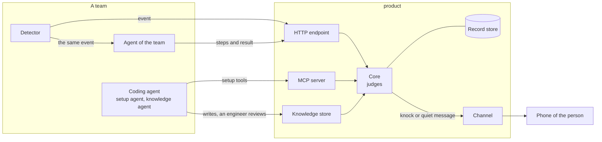

# Architecture map

The parts of product, how they connect, and why each part is built this way. Each change request that
adds a part adds a row. [`product.md`](product.md) says what product is.

The core of product serves more than one use case, so this document uses generic words. The section
[The on-call use case](#the-on-call-use-case) shows the same flow in the words of on-call.

## Terminology

- An event is something that happened and that can need a person. In on-call an event is an alert.
- The detector is the system that watches another system and raises events. In on-call the detector is
  the monitoring of the team.
- The agent of the team is the agent that works on an event. A step is one tool call of that agent with
  its output. The result is the last message of the agent, when its work on the event ends.
- The person in the loop is the person who gets the knock. The rest of this document says "the person".
- A team is the client of product. It is a human-agent team with its own configuration, its own tokens
  and its own data.
- A knock is a push to the person to act now. A quiet message is a push that wakes nobody.
- The product lab is the installation where a use case is measured against scenarios with a known
  answer.

## The flow

The detector raises an event and sends it to the agent of the team and to product. product does not
start the agent. The agent sends its steps and its result to product. Each sender has its own token,
and each token belongs to one team. product rejects a call with no valid token and records the
rejected call.

The core judges at three moments: when the event arrives, when the result arrives, and when the time
limit passes. Rules decide the clear cases, and no model takes part in a rule. An urgent event is such
a case, and it gets a knock at once. For the other results a model reads the event, the result, and the
knowledge about the services of the team. The model returns a confidence number, and a threshold turns
the number into a knock or a quiet message. The channel sends the knock or the quiet message to the
phone of the person. The first version uses the steps only for the content of a knock. A later version
also checks the result against the steps.

The rules, the model with its instruction and its threshold, and the time limit are configuration. A
use case is a set of defaults for them. The configuration of a team starts as a copy of the defaults of
its use case, and the team changes its own copy. The core holds only the code that reads the
configuration and applies it. The code of the core does not include specifics of a use case, and a test
checks this.

A team connects its detector and its agent to product once, at setup. The setup agent and the
knowledge agent are two skills. An engineer of the team runs them in a coding agent, the tool that the
engineer uses to write code, inside the repository of the team. The setup agent writes the
configuration, and the knowledge agent writes the knowledge. The engineer reviews and applies the
result. The two skills reach product through its MCP server. MCP is the standard way for an agent to
call the tools of a service. The two skills work at setup only. At run time product runs its code and
one model call per judgement.

The setup agent, the knowledge agent and the MCP server belong to the first version. In the first
version the team is the product lab, and the engineer who runs the lab is its person.

## How the core behaves

- The detector gives each event an identity. Two events are the same when they have the same identity
  and the same start time. An event stays open until the detector says that it is closed. A repeat of
  an open event starts no new judgement and no new message.
- Each call of the agent names its event with the identity and the start time. The agent works on one
  event at a time in one run. product records a call that names an event it does not know, and that
  call starts nothing.
- A result that arrives late gets a quiet message and no knock. A result is late when the time limit
  already caused a knock, or when the event is already closed. The record keeps the late result.
- The time limit starts when the event arrives at product. It is a setting of the team, with a
  default. The default comes from a measurement of the agent in the product lab.
- A team sets a limit on the cost of model calls per day. At the limit product calls no model. It
  knocks, with the evidence and the reason.
- A channel answers "accepted" or "failed". product tries a failed push again, and the number of tries
  is a setting. The record holds each try.
- The record holds every input of a judgement, the full output of the model, and the cost of the model
  call. A replay reads the stored output and applies the rules and the threshold again, with no model
  call. A changed model or a changed instruction needs a new call. That is an evaluation, and it is not
  a replay.

## Where product runs and where the data goes

product has two ways to run. In the self-hosted way a team installs product in its own environment,
and its data stays there. In the hosted way one installation serves many teams. The first version is
the self-hosted way. One Docker Compose file is the installation, and it holds product and PostgreSQL.
The hosted way comes later. Each stored row holds its team from the first version, and a team reads its
own rows only.

product stores events, steps, results and the knowledge about the services of a team. Steps and
results can hold log lines and customer data. The data leaves product at two points: the model call
and the push to the phone. A team chooses its model and its channel in the configuration. product
calls the model with an API key of the team, and keys stay outside the repository.

A channel protects the content of a push from each server outside the team. The first version has one
kind of channel, a push to a phone, and it ships two free push apps for it. Bark serves an iPhone, and
product encrypts each push with a key that only the phone holds. ntfy serves an Android phone. ntfy
has no such encryption, so a push through ntfy carries a short text with no evidence.

## Parts

| Part | What it does, and why it is built this way | Where | Since |
|---|---|---|---|
| Core | Judges at the event, at the result and at the time limit. Reads the configuration and applies it. Its code does not include specifics of a use case | `src/core/` holds the judgement at the event with rules. The rest is planned | |
| HTTP endpoint | Accepts the calls with events, steps and results, checks the token and the input, and passes them to the core. It is thin and sits outside the core, so the hosted way can run it as a service | `src/http/` holds `POST /events`, which checks the four values of an event and passes them to the core. The token, steps and results are planned | |
| Start of the process | Starts product as one process with `node src/main.ts`. It reads three settings: `PRODUCT_RECORD_FILE`, `PRODUCT_PORT` (default 8080) and `PRODUCT_HOST` (default `127.0.0.1`). Choice: Node runs the TypeScript files as they are, with no build step. Reason: one command starts product with nothing to build first | `src/main.ts` and `src/settings.ts`. `src/first-rule.ts` holds the first rule until the configuration exists | |
| Test of the product | Starts product as a process, sends the events of a scenario to its HTTP endpoint, and compares the messages of the recording channel with the known answer of the scenario. Run it with `node product-test/run.ts`; `pnpm test` does not run it. The contract names this command as its product test, so the job `product` of each change request runs it. Choice: one process of product for each scenario, with port 0 and its own record file. Reason: no scenario sees the events or the open events of another one, so the order of the scenarios changes no result | `product-test/` holds the runner, and `product-test/scenarios/` holds one JSON file for each scenario. A new scenario is a new file |  |
| Event format | A map from the format of one detector to the four values that the core needs: the state of the event, its identity, its start time, and whether it is urgent. A map is configuration, so a new detector needs no change in the core | planned | |
| Result input | One interface, "a result arrived", with one way per kind of agent as configuration. Agents differ in how they send a result, and the core does not see the difference | planned | |
| Model | Calls the model that the configuration selects. One setting holds the model, its instruction and its threshold, because a threshold is valid for one model only | planned | |
| Record store | PostgreSQL. Holds the record and the open events. A database server lets the open events survive a restart and keeps the hosted way possible | planned | |
| Knowledge store | Markdown files in git about the services of a team, in the [Open Knowledge Format](https://github.com/GoogleCloudPlatform/open-knowledge-format) of Google Cloud. An engineer of the team reviews each change. Open point: how the files reach a hosted product | planned | |
| Channel | An interface with two levels: a knock is the highest, and a quiet message is the lowest. A configuration selects the channel. More channels can come later, such as PagerDuty, Slack or Telegram. The recording channel writes to a file until the record store exists | `src/core/channel.ts` holds the interface, and `src/channel/` holds the recording channel. The push to a phone is planned | |
| MCP server | Gives the setup agent its tools: ask for a token, send a test event, read a judgement. A tool for the result of an agent comes later | planned | |
| Setup agent | A skill. Writes the configuration for the detector and the agent of a team, with the values that the team decides. Calls the knowledge agent the first time. Its result arrives as a normal change that an engineer reviews | planned | |
| Knowledge agent | A skill. Builds and maintains the knowledge about the services of a team. Open point: what starts it again when the services of the team change | planned | |
| Use case | A set of defaults: the default rules, the default model with its instruction and its threshold, and the template of the rules by which the detector raises events. The first use case is on-call, and it also holds the lab scenarios and the results | planned | |
| product lab | The installation where the on-call use case is measured. See the next section | planned | |

## The on-call use case

In on-call the detector is the monitoring of the team, and an event is an alert. The agent of the team
is the agent that investigates the alert. The person in the loop is the engineer on call. An urgent
event is a severe alert.

The first event format is the format of Alertmanager. Alertmanager is the open source part of the
Prometheus project that sends alerts. It gives each alert a fingerprint, and the fingerprint is the
identity of the event. It sends a firing alert again after a set time, and it sends one more call when
the alert is resolved. The setup agent writes the lines for the configuration file of Alertmanager,
with the address and the token of product, and an engineer of the team applies them.

The first way for the result is the HTTP hooks of Claude Code. A hook is a call that Claude Code sends
by itself at a fixed moment. product uses two moments: after each tool call of the agent, and when the
agent ends its work. The model cannot skip the call, and the agent needs only configuration. This way
serves an agent that is built on Claude Code. An agent that is built in another way needs another way
to send its result.

The first candidate for the model is Jev, a decision model that returns a probability for each option.
The probability of the option "a person is needed" is the confidence number. A Claude model that writes
its own confidence number is the comparison. The choice is open until the product lab compares them.

The product lab runs the lab scenarios of the on-call use case. One Docker Compose file names its five
lab parts and their versions. Two of them are the installation, product and PostgreSQL. The other
three are the lab service, Prometheus and Alertmanager. One file gives the same run on another
computer, and each lab part can stop alone. Prometheus reads the measurements of the lab service, and
its alert rules are the template of the rules for the detector. Alertmanager sends each alert to two
destinations: product and the agent that investigates. The agent is a separate product and is not a
part of this repository. It runs outside the compose file, with the login of the engineer who runs it,
and it accepts the call of Alertmanager itself. In a lab run a recording channel takes the place of the
phone. It sends no push, and it writes each knock and each quiet message to the record.
